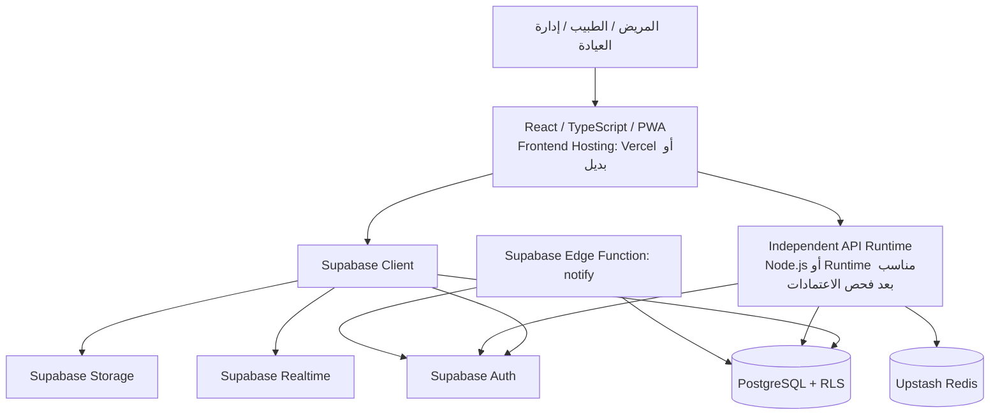

# خطة تنفيذ استقلال Smart Diet عن Vercel

**المشروع:** Smart-diet-v2  
**تاريخ إعداد الخطة:** 17 نوفمبر 2026  
**مرجع جرد المشروع:** `smart-diet-dashboard-ALL-features-2026-11-12.md`  
**نوع العمل:** فصل الاستضافة وطبقة الخادم عن مركز البيانات، دون إعادة بناء التطبيق  
**الأولوية:** الحفاظ على بيانات المرضى والعيادات، ثم تقليل الاعتماد على Vercel، ثم إثبات قابلية النقل

---

## 1. الملخص التنفيذي

الهدف هو أن يصبح **Supabase هو مركز البيانات والمصادقة والخدمات الخلفية التي تعتمد عليها بيانات Smart Diet**، بينما تصبح واجهة React / PWA قابلة للنشر على Vercel أو Cloudflare Pages أو أي استضافة Frontend مناسبة.

لا يعني ذلك نقل كل شيء إلى Supabase، ولا يعني إعادة كتابة التطبيق. المطلوب هو تحديد الاعتمادات الحالية على Vercel، وفصل منطق الخادم عن طريقة تشغيله، ثم نشر نسخة تحقق على استضافة ثانية باستخدام **مشروع Supabase نفسه**.

**حد معماري ملزم للإشعارات:** تبقى جميع عمليات تسجيل Web Push والتحقق والتوقيع والإرسال في Supabase. أي Worker قد يُستخدم لاحقًا لتشغيل واجهة التطبيق أو API جلسة PIN هو مسار استضافة مستقل، وليس بديلًا عن Supabase Edge Function `notify` ولا وسيطًا لها.

### النتيجة النهائية المطلوبة

1. قاعدة PostgreSQL والمستخدمون والجداول والبيانات تظل في مشروع Supabase الحالي.
2. Supabase Auth يظل مسؤولًا عن الحسابات وتسجيل الدخول.
3. PostgreSQL RLS يظل طبقة العزل الأمني الأساسية بين العيادات والأدوار.
4. Supabase Storage وRealtime يستمران دون نقل أو استبدال.
5. واجهة React / PWA لا تفترض أن API يعمل على نفس نطاق الواجهة أو على Vercel تحديدًا.
6. منطق API يعمل في بيئة مستقلة عن Vercel، مع الإبقاء على Vercel كخيار استضافة للواجهة أو كخيار رجوع.
7. Supabase Edge Function `notify` الحالية تظل في مكانها؛ لا يعاد إنشاء Cloudflare Worker الذي حُذف سابقًا.
8. يمكن اختبار الاستضافة الثانية ثم الرجوع إلى Vercel دون نقل قاعدة البيانات أو إنشاء حسابات جديدة.

### مبدأ التنفيذ

**نغيّر حدود الاستضافة، لا المنتج.** لا نعيد تصميم الداشبورد، ولا نعيد بناء ميزات المرضى أو الأطباء أو المالك، ولا نغير نموذج الاشتراكات B2B، ولا نغيّر الحسابات السريرية أو معادلات التغذية ضمن هذا العمل.


## 1.1 تصحيح معماري وحالة التنفيذ — 18 نوفمبر 2026

هذا القسم أحدث من لقطة الجرد المؤرخة 12 نوفمبر، ويُقدّم على أي وصف قديم داخل هذه الخطة:

- PR #72 مدمج: الإشعارات انتقلت فعليًا إلى Supabase؛ `src/platform/push.ts` ينادي عنوان `functions/v1/notify` مباشرة، والـ Edge Function نشطة في Production (v5) وStaging (v2 بعد نشر تصحيح PR #76) مع JWT verification.
- قاعدة التسجيل الحالية هي `public.push_subscriptions`، وتحفظ endpoint فقط. تسجيل endpoint محكوم بـ RLS ودالة `claim_push_subscription` بنمط `SECURITY INVOKER`، مع اشتراط دور patient والعيادة والاشتراك النشطين.
- أسرار VAPID في Supabase Vault، وليس في Cloudflare أو متغيرات `VITE_*`. الحمولة المرسلة حاليًا فارغة عمدًا؛ لا تعتمد على وصف الجرد القديم بأنها JSON نصي.
- PR #75 المفتوح يضيف Worker منفصلًا لتشغيل ملفات الواجهة ومسارات Coach API. وفق نص PR، الـ Worker لم يُنشر، وسير النشر يدوي. فحص حساب Cloudflare الحي في 18-11-2026 أظهر Worker واحدًا باسم `youngtube-worker` وDurable Objects تابعة له، ولم يظهر Worker باسم `smart-diet-v2`؛ لا تخلط Worker المشروع الآخر مع Smart Diet. هذا المسار المقترح لا يملك أي دور في Push، ويجب ألا يمرر `notify`.
- تم اكتشاف نقص توافق لعناوين Chrome/Chromium؛ عنوان Web Push المعتاد يبدأ بـ `https://fcm.googleapis.com/fcm/send/`. التصحيح أُضيف إلى فرع Staging/PR مستقل، وطُبّق تعديل قاعدة Staging فقط للتحقق. لا يُعتبر ذلك إثباتًا لتسليم إشعار على جهاز حقيقي، ولا يعني استخدام FCM Admin SDK أو إعادة Cloudflare.

**مصدر الحقيقة:** `docs/notifications-architecture.md` في المستودع. عند تعارض أي فقرة أقدم مع هذا القسم أو مع الكود المنشور، يُراجع الكود وحالة المشروع الحية وتُحدّث الخطة قبل التنفيذ.

---

## 2. خط الأساس: ما نعرفه من جرد المشروع

هذه الخطة مبنية على جرد المشروع المؤرخ 12 نوفمبر 2026، وعلى وصف البنية الحالي الوارد في طلب المشروع. يجب إعادة التحقق من حالة GitHub والبيئة المنشورة قبل تعديل أي ملف؛ فالجرد لقطة زمنية وليس إثباتًا آنيًا لكل إعداد إنتاجي.

### 2.1 عناصر موجودة بالفعل ولا ينبغي إعادة بنائها

| العنصر | الحالة الواردة في الجرد | قرار التنفيذ |
|---|---|---|
| Supabase PostgreSQL | التقنية الحالية بدل Firebase / Firestore | الإبقاء على المشروع وقاعدة البيانات الحالية |
| Supabase Auth | مصادقة الحسابات الحالية | عدم استبدالها أو إنشاء نظام حسابات جديد |
| RLS | مطبق على مستوى قاعدة البيانات، مع وجود أعمال تقوية سابقة | مراجعة التغطية واختبار العزل، لا إعادة كتابة عشوائية |
| Supabase Storage | ضمن البنية الحالية | الإبقاء عليه ومراجعة السياسات فقط |
| Supabase Realtime | جزء من البنية المستهدفة الحالية | الإبقاء عليه والتحقق من صلاحيات القنوات |
| Supabase Edge Function `notify` | نشطة في Production (version 5) وStaging (version 2 بعد نشر PR #76) وفق فحص 18-11-2026، و`verify_jwt = true` في كليهما | الإبقاء على الإرسال المباشر من المتصفح إلى Supabase وعدم إنشاء وسيط آخر |
| سجل Push | `public.push_subscriptions` مع RLS وتسجيل مقيد عبر `claim_push_subscription`؛ `endpoint` فقط هو المخزن | لا تُعد `fcm_tokens` أو تخزين JSON الكامل؛ لا تُخفّف RLS |
| مفاتيح VAPID | المفتاح الخاص والموضوع محفوظان في Supabase Vault ويُقرآن عبر `get_push_signing_config` بصلاحية `service_role` فقط | لا تضع الأسرار في `VITE_*` أو Cloudflare أو Git |
| Cloudflare Worker القديم للإشعارات | حُذف في PR #32، ثم ثُبّت النقل إلى Supabase في PR #72 | ممنوع إعادته إلى مسار الإشعارات |
| Cloudflare Worker في PR #75 | مسار منفصل مقترح لاستضافة أصول الواجهة و`/api/*` و`/health` و`/coach-session`؛ PR مفتوح، والنشر يدوي وغير منفّذ وفق وصفه | لا يمرر `notify` ولا يخزن Push endpoints أو أسرار VAPID؛ لا يُعد اعتمادًا للإشعارات |
| تسجيل الدخول بالبريد | Supabase Auth | الإبقاء عليه |
| Google OAuth للطاقم | موجود ضمن تدفق الدخول | مراجعة Redirect URLs عند تغيير النطاق |
| مزامنة الخطة والسجلات | مسارات سحابية موجودة مع موافقة صريحة للسحابة | عدم إعادة تصميم المزامنة ضمن مشروع الاستضافة |

### 2.2 الاعتمادات الحالية التي تحتاج معالجة

| العنصر | ما ورد في الجرد / وصف المشروع | المطلوب |
|---|---|---|
| `api/index.ts` | Express يعمل عبر بيئة Vercel | فصل منطق التطبيق عن Adapter الاستضافة |
| `vercel.json` | يوجّه `/api` إلى خادم Vercel | إبقاؤه مؤقتًا كطبقة تشغيل حالية، لا كجزء من منطق المنتج |
| `/api/coach-session` | التحقق من PIN الدكتور يتم عبر API على Vercel | تشغيل الوظيفة نفسها عبر API مستقل دون إضعاف التحقق |
| Upstash Redis | Rate Limiting مشترك بين نسخ Vercel حاليًا | التأكد من أن الخدمة لا تعتمد على Runtime أو متغيرات Vercel الخاصة |
| `src/platform/supabase.ts` | ينشئ اتصال Supabase باستخدام متغيرات `VITE_SUPABASE_*` وفق وصف المشروع | الإبقاء على نمط الاتصال والتحقق من كل الاستخدامات |
| `src/platform/auth.tsx` | يستخدم Supabase Auth ويقرأ دور المستخدم والعيادة من `profiles` وفق وصف المشروع | الإبقاء على المصادقة، مع مراجعة النطاقات المسموح بها |
| عناوين API في الواجهة | يجب التحقق من وجود عناوين ثابتة أو مسارات نسبية تفترض Vercel | توحيد مصدر عنوان API في طبقة إعدادات واحدة |

### 2.3 فجوات أمنية أو تشغيلية مسجلة في الجرد

هذه ليست ميزات جديدة، لكنها فجوات يجب التعامل معها لأنها تؤثر في أمان نقل التطبيق وتشغيله.

| المرجع | الحالة الواردة في الجرد | مستوى التعامل |
|---|---|---|
| PRIV-001 | عزل بيانات `localStorage` و`IndexedDB` حسب UID ما زال في مرحلة التحليل | مطلوب قبل اعتبار تبديل الحسابات على الجهاز آمنًا |
| TEST-001 | اختبارات تكامل RLS الحية لم تكتمل؛ الموجود فحص ثابت فقط | مطلوب اختبار حي مركز لأدوار وجداول حساسة |
| Migrations | Baseline تعليقي، وليس سجلًا تنفيذيًا كاملًا قابلًا لإعادة البناء | مطلوب إغلاق الفجوة بحذر بعد مطابقة مخطط الإنتاج |
| RFC 8291 | تنفيذ PR #72 يرسل طلب Web Push بلا payload؛ Service Worker يعرض رسالة عامة | الوضع الحالي لا يرسل بيانات تطبيقية في الحمولة. أي حمولة مستقبلية غير فارغة تتطلب تشفير RFC 8291 واختبارًا مستقلًا قبل تفعيلها |
| PWA-001 | إعداد Service Worker موجود، لكن اختبار متصفح E2E غير مكتمل | إجراء تحقق متصفح محدود عند تجربة النشر البديلة |
| Owner profile | صف `profiles` لحساب مالك المنصة لم يكن قد أُنشئ وفق الجرد | تحقق من الحالة الحالية؛ ليس جزءًا من نقل الاستضافة إلا إذا منع اختبار الأدوار |

**قاعدة مهمة:** لا تُعالج كل هذه الفجوات بفتح مشروع جانبي طويل. نعالج ما يمنع سلامة البيانات أو تشغيل النسخة البديلة فقط، ونضع ما لا يمنع الاستقلال في قائمة منفصلة واضحة.

---

## 3. النطاق والمهام المستبعدة

### 3.1 داخل النطاق

- جرد الاعتماد على Vercel في الكود والإعدادات وسير النشر.
- فصل منطق Express عن Adapter تشغيل Vercel.
- إنشاء مدخل تشغيل مستقل للخادم يمكن نشره خارج Vercel.
- فصل عنوان API عن نطاق واجهة React.
- ضبط CORS وOAuth وRedirect URLs بما يناسب أكثر من نطاق.
- تثبيت متغيرات البيئة والأسرار في كل خدمة على حدة.
- مراجعة Supabase Migrations وRLS وStorage وRealtime بقدر ما يلزم لإثبات الاستقلال والأمان.
- مراجعة Upstash Rate Limiting ليعمل مع بيئة API البديلة.
- تأمين البيانات المحلية عند تسجيل الخروج وتبديل الحسابات.
- نشر نسخة اختبارية على استضافة ثانية باستخدام Supabase الحالي.
- إجراء تحقق تشغيلي وأمني محدود، ثم قرار التحويل أو الإبقاء على Vercel.

### 3.2 خارج النطاق صراحة

- إعادة تصميم واجهات Owner / Clinic Admin / Doctor / Patient.
- تنفيذ الـ 233+ ميزة المدرجة في ملف الداشبورد.
- نقل قاعدة البيانات إلى مزود آخر أو إنشاء مشروع Supabase جديد.
- استبدال Supabase Auth أو كتابة نظام مصادقة جديد.
- تغيير نموذج الاشتراك B2B أو آلية الدفع اليدوي.
- تغيير الحاسبات السريرية أو وصفات التغذية أو المنطق الطبي.
- إعادة كتابة التطبيق إلى إطار Frontend آخر.
- نقل `notify` إلى Cloudflare Worker أو تمرير طلبها عبر Worker أو إنشاء أي fallback إشعارات خارج Supabase.
- إدخال خدمات جديدة لمجرد تنويع مزودي الخدمة.

أي تعديل خارج هذا النطاق يحتاج مبررًا تقنيًا مباشرًا يثبت أنه شرط لتشغيل النسخة المستقلة أو حماية بياناتها.

---

## 4. المعمارية المستهدفة



### 4.1 مسؤولية كل طبقة

| الطبقة | المسؤولية | ما يجب ألا تفعله |
|---|---|---|
| Frontend | عرض الواجهات، إدارة تجربة المستخدم، استدعاء Supabase وAPI | لا تحتوي مفاتيح سرية ولا تنفذ صلاحيات إدارية موثوقة بنفسها |
| Supabase Auth | إثبات هوية المستخدم وإدارة الجلسة | لا يُستبدل بمصادقة محلية أو Vercel Identity |
| PostgreSQL + RLS | حفظ البيانات والتحقق من صلاحية الوصول على مستوى الصفوف | لا تعتمد على إخفاء الأزرار في الواجهة كبديل عن RLS |
| Storage | ملفات ومرفقات التطبيق وفق سياسات الوصول | لا تجعل الروابط العامة بديلًا عن سياسات التخزين الخاصة |
| Realtime | تحديثات فورية وفق صلاحيات القنوات والبيانات | لا يكشف أحداث عيادة أخرى |
| Independent API | العمليات الحساسة أو التي تحتاج أسرارًا وخادمًا موثوقًا | لا يخزن نسخة موازية من بيانات Supabase بلا ضرورة |
| `notify` Edge Function | إرسال Web Push وفق التحقق الحالي | لا تُحمّل بيانات صحية حساسة في payload غير مشفر |
| Upstash Redis | حالة Rate Limiting مشتركة | لا يعتمد على وجود نسخة Vercel معينة |

### 4.2 قاعدة أمنية للمفاتيح

- `VITE_SUPABASE_URL` و`VITE_SUPABASE_ANON_KEY` إعدادات متاحة للمتصفح؛ لا تُعامل كمفاتيح سرية.
- لا يوضع `service_role` أو أي Secret داخل متغير يبدأ بـ `VITE_`.
- مفاتيح Supabase الإدارية ومفاتيح Upstash وأسرار التوقيع تكون في بيئة الخادم أو Edge Function فقط.
- لا تُطبع القيم السرية في Logs أو رسائل الخطأ أو تقارير GitHub.

---

## 5. خطة التنفيذ التفصيلية

## المرحلة صفر — تثبيت خط الأساس وجرد الاعتمادات

**الهدف:** معرفة ما يعتمد على Vercel بالفعل قبل تغيير أي شيء.

### خطوات التنفيذ

1. فتح آخر نسخة من الفرع الرئيسي وتسجيل Commit SHA الذي ستبدأ منه الخطة.
2. التأكد من حالة الإنتاج الحالية: نطاق الواجهة، نطاق API، مشروع Supabase المستخدم، وحالة آخر نشر ناجح.
3. مراجعة `package.json` وملفات إعداد البناء والتشغيل لمعرفة أوامر Build وStart والاعتمادات التي تحتاج Node Runtime.
4. مراجعة `api/index.ts` و`vercel.json` وتحديد جميع المسارات الفعلية، وليس افتراض وجود `/api/coach-session` وحده.
5. البحث في الكود عن:
   - `vercel` و`@vercel` وأي Runtime-specific imports.
   - مسارات `/api` الثابتة.
   - `window.location.origin` أو URLs مكتوبة يدويًا في OAuth أو API.
   - متغيرات البيئة التي تقرأها الواجهة أو الخادم.
   - إعدادات CORS وCookie وHeaders.
6. مراجعة مواضع استخدام `src/platform/supabase.ts` و`src/platform/auth.tsx` دون إعادة كتابة الاتصال الموجود.
7. مراجعة `/api/coach-session` وطرق استدعائه من الواجهة؛ توثيق طريقة إرسال PIN والتحقق من النتيجة وحدود المحاولات.
8. مراجعة إعداد Upstash الحالي: أين تُقرأ بيانات الاتصال؟ وهل يعتمد Rate Limiting على بيانات Vercel الخاصة أم على متغيرات عامة يمكن ضبطها في أي Runtime؟
9. مراجعة GitHub Actions أو إعدادات النشر الحالية لمعرفة ما الذي يبني الواجهة وما الذي ينشر API.
10. إنشاء جدول جرد صغير: المسار، الملف، نوع الاعتماد، قرار المعالجة، حالة التنفيذ.

### المخرجات

- خريطة لكل API route واستخداماته.
- قائمة بكل متغيرات البيئة، مع تصنيفها إلى Frontend public وBackend secret وSupabase Edge Function secret.
- قائمة الاعتمادات الخاصة بـ Vercel التي يجب فصلها.
- Commit SHA وخط رجوع معروف.

### معيار الإغلاق

لا يبدأ فصل الخادم قبل معرفة كل المسارات الفعلية وكل مكان تستدعي فيه الواجهة API. لا حاجة لتشغيل اختبارات شاملة في هذه المرحلة؛ المطلوب جرد ثابت يمكن مراجعته.

---

## المرحلة الأولى — تثبيت استقلال Supabase والبيانات

**الهدف:** التأكد من أن بيانات Smart Diet ومخططها وصلاحياتها لا تعتمد على دورة حياة نشر Vercel.

### 1.1 مراجعة الاتصال

1. مراجعة `src/platform/supabase.ts` والتأكد من أن مصدر عنوان المشروع والمفتاح العام هو متغيرا البيئة الحاليان.
2. التأكد من عدم بناء عنوان Supabase من نطاق Vercel أو اسم المشروع أو عنوان API.
3. التأكد من أن تغيير عنوان الواجهة لا يغير `SUPABASE_URL` أو مشروع Supabase المقصود.
4. مراجعة جميع نقاط إنشاء Supabase Client؛ تقليل النسخ المتعددة إن وُجدت، دون تغيير سلوك المصادقة.

### 1.2 مراجعة المصادقة

1. مراجعة `src/platform/auth.tsx` وتدفق استعادة الجلسة وقراءة `profiles`.
2. التأكد من أن الأدوار (`owner` و`admin` و`coach` و`patient`) لا تُستنتج من قيمة يرسلها المتصفح دون تحقق موثوق.
3. فحص حالة الحساب المعطل `profiles.disabled` في الأماكن الحساسة، وليس في الواجهة فقط.
4. مراجعة Redirect URLs المسموحة في Supabase Auth؛ إضافة نطاق الاختبار الجديد دون حذف نطاق الإنتاج الحالي.
5. مراجعة إعداد Google OAuth لدى المزود، إذا كان Callback URL يحتاج تحديثًا.
6. تجربة تسجيل الدخول والخروج واستعادة الجلسة بعد النشر على نطاق الاختبار.

### 1.3 مراجعة RLS والعزل بين العيادات

1. استخراج قائمة الجداول التي تحمل `clinic_id` أو ترتبط بمريض أو طبيب أو دعوة أو اشتراك.
2. تصنيف الجداول حسب الأدوار التي يُسمح لها بالقراءة والكتابة.
3. مراجعة السياسات الحالية مقابل نموذج B2B: عيادة واحدة باشتراك يغطي أطباءها ومرضاها.
4. التركيز على العمليات التي قد تتجاوز نطاق العيادة: القراءة، التعديل، الحذف، الإدراج، RPC، وعمليات `SECURITY DEFINER`.
5. الاحتفاظ بتقويات الجرد السابقة، ومنها `search_path = ''` وسحب صلاحية EXECUTE العامة من الدوال الحساسة حيث تنطبق.
6. عدم اعتبار إخفاء البيانات في React دليلًا على سلامة العزل.
7. إعداد اختبارات حية محدودة بمستخدمين من عيادتين مختلفتين وأدوار مختلفة؛ يجب إثبات نجاح الوصول المصرح وفشل الوصول غير المصرح.

### 1.4 مراجعة Migrations — بحذر خاص

الجرد يسجل أن Baseline الحالي تعليقي، وليس سلسلة كاملة من Migrations التنفيذية القابلة لإعادة البناء.

خطوات المعالجة:

1. أخذ نسخة احتياطية موثقة من قاعدة الإنتاج قبل أي تغيير في المخطط.
2. استخراج المخطط الفعلي من Supabase ومقارنته بملفات SQL الموجودة.
3. حصر الجداول والفهارس والقيود والدوال والـ Triggers وسياسات RLS وGrants.
4. تحديد ما هو موجود فعليًا في الإنتاج وما هو موجود في الملفات فقط.
5. وضع Baseline يعكس الحالة الحقيقية دون إعادة إنشاء كائنات قائمة أو حذف بيانات.
6. اعتماد سجل Migration موثوق يميز بين ما طُبق على الإنتاج وما لم يطبق.
7. تنفيذ أي تغييرات جديدة في ملفات Migration منفصلة، مرتبة، قابلة للمراجعة.
8. تجربة إعادة البناء على قاعدة اختبار نظيفة قبل اعتبار ملفات Migration صالحة لإعادة الاستخدام.
9. عدم تشغيل ملفات Baseline على الإنتاج لمجرد أنها أصبحت موجودة؛ يجب أولًا مطابقة حالتها مع مخطط الإنتاج.

### 1.5 Storage وRealtime

1. مراجعة سياسات Storage الخاصة بالمرفقات والملفات.
2. التأكد من أن مفاتيح المسارات أو Metadata تربط الملفات بالمستخدم والعيادة حسب نموذج الصلاحيات الحالي.
3. عدم تحويل ملفات المرضى إلى روابط عامة لتسهيل النقل.
4. مراجعة Realtime publication وRLS أو آليات التفويض للقنوات.
5. اختبار أن مستخدمًا من عيادة لا يرى تحديثات عيادة أخرى.

### مخرجات المرحلة الأولى

- تقرير موجز لمخطط Supabase المعتمد.
- سجل Migrations واضح ومتوافق مع حالة قاعدة البيانات الفعلية.
- قائمة RLS للجداول الحساسة مع نتائج الاختبار الحي.
- تأكيد أن Supabase لا يعتمد على عنوان الواجهة أو بيئة Vercel.

### معيار الإغلاق

يمكن تبديل عنوان الواجهة أو Runtime الخادم دون تغيير مشروع Supabase أو نقل بياناته، وتنجح اختبارات العزل المحددة.

---

## المرحلة الثانية — فصل API عن Vercel

**الهدف:** تحويل منطق API إلى تطبيق خادم مستقل، والإبقاء على Vercel Adapter كغلاف توافق مؤقت.

### 2.1 جرد المسارات

لكل Route في `api/index.ts`، أنشئ سجلًا يحتوي على:

- المسار HTTP method والمسار الكامل.
- الملفات أو الخدمات التي يستدعيها.
- هل يحتاج إلى Supabase User JWT؟
- هل يستخدم مفتاحًا سريًا أو صلاحية إدارية؟
- هل يستخدم Upstash؟
- هل يقرأ Origin أو Host أو Cookies؟
- هل له حد للمهلات أو أحجام الطلبات؟
- هل يمكن تنفيذه مباشرة في Edge Function أم يحتاج Node Runtime؟

لا تفترض أن كل Endpoint يجب نقله إلى Edge Function، ولا تفترض أن كل Endpoint يجب أن يبقى في Express. القرار يكون بناءً على الاعتمادات الفعلية.

### 2.2 فصل منطق التطبيق عن Adapter التشغيل

الاتجاه المفضل:

```text
api/
  routes/                 # تعريف المسارات
  services/               # منطق العمل
  middleware/             # التحقق والمحددات المشتركة
  server-app.ts            # بناء تطبيق HTTP دون ربطه بـ Vercel
  server.ts                # مدخل تشغيل Node مستقل
  index.ts                 # Vercel adapter رفيع مؤقتًا
```

هذا شكل توضيحي وليس إلزامًا بأسماء أو بنية مجلدات بعينها؛ يجب احترام تنظيم المشروع القائم إن كان يقدم فصلًا مشابهًا.

خطوات التنفيذ:

1. استخراج إنشاء Express app من نقطة تشغيل Vercel.
2. إبقاء تعريف المسارات والـ Middleware في طبقة مشتركة.
3. إنشاء مدخل Node مستقل يستمع إلى Port من البيئة.
4. إبقاء `api/index.ts` كـ Adapter رفيع يصدّر التطبيق بالطريقة التي تتطلبها Vercel، إن كانت لا تزال مستخدمة.
5. التأكد من أن تشغيل Vercel وتشغيل Node المستقل يستعملان منطق التطبيق نفسه، لا نسختين منفصلتين.
6. إضافة معالجة موحدة للأخطاء وطلبات الإغلاق وإشارات Runtime عند الحاجة.
7. عدم تغيير شكل Response أو Status Codes أو أسماء الحقول التي تعتمد عليها الواجهة إلا عند ضرورة موثقة.

### 2.3 نقل `/api/coach-session` دون إضعاف الأمان

هذا Endpoint حساس لأنه يتحقق من PIN الدكتور وفق الجرد.

1. تتبع كيفية إنشاء PIN وتخزينه والتحقق منه حاليًا.
2. التأكد من عدم وصول PIN أو Secret إلى المتصفح أو Logs.
3. إبقاء الإنتاج Fail Closed: إذا تعذر التحقق من الخادم، لا يُنشأ PIN محلي بديل.
4. الحفاظ على Rate Limiting وحدود محاولات التخمين.
5. التحقق من هوية المستخدم وسياق العيادة قبل قبول العملية وفق القواعد الحالية.
6. تشغيل Endpoint من الـ API المستقل.
7. إبقاء Vercel Route مؤقتًا يمرر إلى منطق الخادم نفسه أو يظل Adapter متوافقًا، حتى يثبت المسار البديل.
8. اختبار نجاح PIN الصحيح، رفض PIN الخاطئ، رفض المستخدم غير المصرح، ورفض الطلب عند تعطل التحقق.

لا يجوز تحويل فشل API إلى قبول محلي أو تخفيف عدد المحاولات لتسهيل اختبار النقل.

### 2.4 Upstash Rate Limiting

1. مراجعة أسماء متغيرات Upstash الفعلية في المشروع بدل افتراض أسماء جديدة.
2. فصل قراءة الإعدادات عن Vercel-specific configuration.
3. توفير نفس بيانات Upstash في بيئة API البديلة من إعدادات أسرار الخادم.
4. التأكد من أن جميع نسخ API تستخدم مساحة Rate Limiting مشتركة.
5. التأكد من أن مفتاح العميل أو المستخدم الذي يحدد حد المحاولات لا يمكن التلاعب به بطريقة تسمح بتجاوز الحماية.
6. اختبار تجاوز الحد، انتهاء النافذة، واستمرار الحد عند توجيه الطلبات إلى أكثر من نسخة.
7. عدم تسجيل مفاتيح Upstash أو Tokens في Logs.

### 2.5 CORS وCookies وHeaders

1. تحديد النطاقات المسموحة صراحة: نطاق الإنتاج ونطاق Preview المصرح به عند الحاجة.
2. عدم استخدام `Access-Control-Allow-Origin: *` مع Credentials.
3. فحص إعدادات Cookie: `Secure` و`SameSite` و`Domain` إذا كان API يعتمد على Cookies.
4. إذا كانت المصادقة تعتمد Bearer JWT، التأكد من تمرير Authorization Header والتحقق منه خادميًا.
5. التعامل مع Preflight OPTIONS بطريقة صحيحة.
6. ضبط قائمة Headers المسموح بها على الحد اللازم.
7. عدم اعتبار CORS وسيلة مصادقة؛ يظل التحقق من JWT والصلاحيات مطلوبًا.

### 2.6 اختيار بيئة API المستقلة

بعد فحص `package.json` والمكتبات وواجهات Node المستخدمة:

- إذا كانت الاعتمادات متوافقة مع Node Server عادي، يُنشر الخادم كخدمة Node مستقلة.
- إذا كان Endpoint معين خفيفًا ولا يحتاج Node APIs، يمكن تقييم نقله إلى Supabase Edge Function.
- لا ينقل كامل Express إلى Edge Functions تلقائيًا.
- لا يُعتمد Cloudflare Workers لمجرد أنه بديل لـ Vercel؛ يجب إثبات توافق Express والاعتمادات وقيود Runtime أولًا.
- لا تُسجل خدمة جديدة قبل معرفة ما إذا كان مزود الاستضافة البديل يدعم Runtime المطلوب ومتغيرات البيئة والـ Logs وHealth Checks.

### 2.7 Health Check وObservability

1. توفير مسار Health Check لا يعرض أسرارًا أو بيانات مستخدمين.
2. إرجاع حالة تشغيل عامة وإصدار Build أو Commit عند ملاءمة ذلك.
3. تسجيل أخطاء كافية لتشخيص المشكلات دون تسجيل بيانات صحية أو مفاتيح أو PIN.
4. تمييز أخطاء Auth وRLS وUpstash وأخطاء Runtime.
5. عدم إرجاع Stack Trace للعميل في الإنتاج.

### مخرجات المرحلة الثانية

- تطبيق API مستقل عن Adapter Vercel.
- Vercel Adapter رفيع أو متوافق خلال فترة الانتقال.
- توثيق Routes وبيانات البيئة الخاصة بها.
- `/api/coach-session` يعمل على Runtime مستقل بنفس قواعد الأمان.
- Upstash يعمل بصورة مشتركة خارج اعتماد Vercel.

### معيار الإغلاق

تعمل كل المسارات المستخدمة حاليًا على الخادم المستقل، ولا تعتمد ملفات منطق العمل على كائنات أو متغيرات Vercel الخاصة.

---

## المرحلة الثالثة — تحرير واجهة React / PWA

**الهدف:** ألا تفترض الواجهة أن API موجود على نفس النطاق أو داخل Vercel.

### 3.1 توحيد عنوان API

1. البحث عن جميع استدعاءات `/api/...` في المشروع.
2. تجميعها خلف طبقة API client واحدة إن لم تكن موجودة بالفعل.
3. إضافة إعداد عام لعنوان API، مثل `VITE_API_BASE_URL`، فقط إذا كان ذلك مناسبًا لنمط البناء الحالي.
4. عند عدم ضبط عنوان مستقل، لا يتم افتراض قيمة خاطئة؛ يكون هناك Default واضح يناسب بيئة التطوير أو الإنتاج الحالي.
5. ضمان عدم وجود خلط بين عنوان Supabase وعنوان API.
6. إبقاء مسارات API النسبية متوافقة مؤقتًا إذا كان تغييرها سيكسر استدعاءات قائمة.
7. عدم تمرير Secrets إلى الواجهة لمجرد أن API أصبح على نطاق آخر.

### 3.2 مصفوفة متغيرات البيئة

| المتغير / النوع | مكان الاستخدام | سري؟ | ملاحظات |
|---|---|---|---|
| `VITE_SUPABASE_URL` | Frontend | لا | عنوان مشروع Supabase الحالي |
| `VITE_SUPABASE_ANON_KEY` | Frontend | لا، مفتاح عام | حماية البيانات تعتمد على Auth وRLS |
| `VITE_API_BASE_URL` | Frontend | لا | عنوان API المستقل، إذا اعتمد هذا الاسم بعد مراجعة نمط المشروع |
| Supabase Service Role / Secret Key | Backend فقط | نعم | لا يبدأ بـ `VITE_` ولا يُرسل للمتصفح |
| Upstash URL / Token | Backend فقط | نعم | تُقرأ من بيئة الخادم |
| VAPID private key وأسرار Push | Edge Function / Backend حسب التنفيذ | نعم | لا تدخل في حزمة React |
| مفاتيح OAuth السرية | مزود OAuth / بيئة الخادم إن انطبقت | نعم | لا توضع في متغيرات Frontend |

هذه أسماء توضيحية للأنواع. قبل اعتمادها، تُراجع أسماء المتغيرات الحالية في الكود ولوحات إعدادات الخدمات لتجنب خلق متغيرات مزدوجة بلا داعٍ.

### 3.3 Auth وOAuth بعد تغيير نطاق الواجهة

1. إضافة نطاق Preview أو الاختبار في Redirect URLs.
2. إضافة Callback URL المطلوبة في Google OAuth Console، إن اختلفت.
3. إبقاء نطاق الإنتاج الحالي في القوائم حتى اكتمال الانتقال.
4. اختبار التسجيل بالدعوة وتسجيل الدخول بالبريد وGoogle للطاقم.
5. اختبار انتهاء الجلسة وتجديدها وتسجيل الخروج.
6. توقع احتمال مطالبة بعض المستخدمين بتسجيل الدخول مجددًا بعد تغيير النطاق؛ لا يُعتبر ذلك فقدًا للحسابات أو البيانات.

### 3.4 PWA وService Worker

1. مراجعة إعدادات `manifest` وService Worker وStart URL وScope.
2. فحص Cache للـ API؛ لا يجوز تخزين استجابات خاصة بمرضى في Cache عام أو مشترك.
3. إبقاء البيانات الثابتة المناسبة فقط ضمن Precache.
4. التأكد من أن التنقل عند انقطاع الشبكة يستخدم Fallback دون إظهار بيانات مستخدم سابق.
5. مراجعة تبديل المستخدم وتسجيل الخروج ومسح البيانات ذات الصلة.
6. التحقق من أن API الجديد لا يُخزَّن في Cache بطريقة تعيد استجابة قديمة أو تخص مستخدمًا آخر.
7. تنفيذ اختبار متصفح واحد مركز على التثبيت والتحميل والتنقل وتسجيل الخروج بدل بناء منظومة E2E موسعة لهذه المهمة.

### 3.5 عزل البيانات المحلية بين الحسابات — PRIV-001

الجرد يسجل أن هذا البند ما زال تحليلًا، لذلك يجب عدم اعتباره منجزًا.

1. جرد مفاتيح `localStorage` وقواعد `IndexedDB` المستخدمة للبيانات الخاصة بالمريض.
2. تصنيف البيانات إلى بيانات عامة غير شخصية وبيانات خاصة بمستخدم.
3. ربط Namespace أو Store للبيانات الخاصة بـ Supabase UID.
4. عند تسجيل الخروج، منع استمرار وصول الحساب التالي إلى بيانات الحساب السابق.
5. عند تبديل الحساب، تحميل مخزن الحساب الجديد فقط.
6. وضع استراتيجية لمسح أو قفل البيانات الخاصة عند انتهاء الجلسة.
7. عدم حذف بيانات محلية قد تكون غير متزامنة بصمت؛ تحديد سياسة واضحة للتعامل معها قبل المسح.
8. اختبار حسابين مختلفين على نفس المتصفح والجهاز، مع فصل البيانات في الاتجاهين.

### مخرجات المرحلة الثالثة

- واجهة تعتمد إعدادًا عامًا للـ API.
- متغيرات Frontend منفصلة عن Secrets الخادم.
- OAuth وCORS يعملان مع نطاق الاختبار.
- PWA يعمل على النطاق الجديد دون Cache أو Local Data Leakage.
- بيانات الحسابات المحلية معزولة حسب المستخدم.

### معيار الإغلاق

يمكن بناء الواجهة وإطلاقها على نطاق مختلف مع تغيير إعدادات البيئة والنطاقات فقط، دون تعديل منطق العمل أو نقل البيانات.

---

## المرحلة الرابعة — الإشعارات والخدمات المساندة

**الهدف:** الحفاظ على الخدمات القائمة وعدم خلق اعتماد جديد على Vercel.

### 4.1 Edge Function `notify`

1. التحقق من وظيفة `notify` المنشورة في Production وStaging؛ حالة الفحص في 18-11-2026: ACTIVE، Production version 5 وStaging version 2، و`verify_jwt = true` في المشروعين.
2. الحفاظ على التحقق من هوية المستخدم عبر Supabase JWT، ثم الدور والعيادة والمريض وحالة الاشتراك والحساب المعطل.
3. يجب أن يستدعي المتصفح مباشرة `{VITE_SUPABASE_URL}/functions/v1/notify`؛ يمنع تمرير الطلب عبر Vercel API أو Cloudflare Worker أو أي API proxy.
4. تسجيل endpoint للمريض في `public.push_subscriptions` عبر Supabase، مع RLS وقيود clinic/subscription الحالية. التخزين الحالي يحتفظ بالـ endpoint فقط.
5. المفتاح العام فقط في `VITE_VAPID_PUBLIC_KEY`. المفتاح الخاص وVAPID subject في Supabase Vault ويصل إليهما `service_role` عبر `get_push_signing_config` فقط.
6. حمولة Push الحالية فارغة؛ لا أسماء ولا تفاصيل صحية. لا تُفعّل أي payload غير فارغ قبل تنفيذ RFC 8291 واختبار التوافق.
7. حصر عناوين Push المسموح بها في مزودي Web Push المعروفين. Chrome/Chromium يستخدم endpoint مثل `https://fcm.googleapis.com/fcm/send/{token}`؛ هذا عنوان مزوّد تسليم للمتصفح وليس استخدامًا لـ FCM Admin SDK أو Cloudflare Worker. إصلاح السماح به يجب أن يحافظ على HTTPS، واسم المضيف والمسار الدقيقين، ورفض النطاقات البديلة.
8. لا تعِد إنشاء Worker القديم للإشعارات. PR #75 يصف Worker منفصلًا للواجهة وCoach API فقط، ولا يجوز له استقبال أو تمرير `notify` أو أسرار VAPID أو Push endpoints.

### 4.2 تشفير Web Push — RFC 8291

التنفيذ الفعلي الذي دخل عبر PR #72 غيّر النموذج: وظيفة `notify` ترسل طلب Web Push بلا body، وService Worker يعرض إشعارًا عامًا عند الاستقبال. لذلك لا توجد حمولة تطبيقية غير مشفرة في المسار الحالي.

- يمنع إضافة أسماء مرضى أو تشخيصات أو وزن أو تحاليل أو محتوى خطة أو أي تفاصيل صحية إلى الإشعار.
- لا تُخزّن حقول `p256dh` و`auth` في الجدول الحالي؛ الجدول يحتفظ بعنوان endpoint فقط.
- أي قرار مستقبلي بإرسال payload يتطلب تنفيذ RFC 8291 (`aes128gcm`) باستخدام مفاتيح اشتراك المتصفح، واختبارات متوافقة مع المتصفحات، ومراجعة أمنية قبل تفعيله.
- لا تخلط بين خلو payload من المحتوى وبين ضمان وصول الإشعار؛ يلزم اختبار أجهزة ومتصفحات فعلية لإثبات التسليم.

### 4.3 Upstash وعمليات API

- يجب أن يستمر Rate Limiting في API Runtime البديل.
- لا يُنقل Rate Limiting إلى Local Memory؛ لأن ذلك لا يشارك الحالة بين النسخ.
- أي عملية حساسة يجب أن تظل Fail Closed عند فشل خدمة الحماية، وفق سياسة الأمان المعتمدة لها.

### معيار الإغلاق

تستدعي الواجهة Supabase Edge Function `notify` مباشرة، ولا يوجد اعتماد على Cloudflare أو Vercel في مسار الإشعارات. لا يحتوي Push payload على بيانات تطبيقية أو صحية. مسار Worker المقترح في PR #75، إن تم اختباره واختياره لاستضافة API، يظل منفصلًا ولا يمرر الإشعارات. يلزم اختبار E2E حقيقي على Chrome وFirefox وSafari/Apple وEdge/Windows قبل اعتبار التوافق والتسليم مكتملين.

---

## المرحلة الخامسة — النشر على استضافة ثانية

**الهدف:** إثبات أن تغيير استضافة الواجهة لا يتطلب نقل Supabase أو إنشاء حسابات جديدة.

### 5.1 بيئة الاختبار

1. اختيار نطاق Preview أو نطاق اختبار منفصل عن النطاق الرئيسي.
2. استخدام مشروع Supabase الحالي، مع التأكد من أن الاختبارات لا تنشئ أو تعدل بيانات إنتاجية حقيقية دون ضرورة.
3. نشر API المستقل على بيئته المناسبة.
4. نشر React / PWA على الاستضافة الثانية.
5. ضبط `VITE_SUPABASE_URL` و`VITE_SUPABASE_ANON_KEY` بالقيم الخاصة بالمشروع الحالي.
6. ضبط عنوان API العام في إعدادات بناء الواجهة.
7. ضبط أسرار الخادم وUpstash في بيئة API المستقلة.
8. إضافة نطاق الاختبار إلى Auth Redirect URLs وCORS.
9. التأكد من HTTPS.
10. عدم تغيير DNS أو تحويل حركة المستخدمين في هذه الخطوة.

### 5.2 سيناريو التحقق العملي

نفذ مرورًا واحدًا على الوظائف الأساسية التالية:

| السيناريو | الإجراء | النتيجة المطلوبة |
|---|---|---|
| دخول المريض | تسجيل الدخول بحساب اختبار | يفتح حسابه وبياناته فقط |
| دخول الطبيب | تسجيل الدخول بحساب اختبار | تظهر بيانات مرضاه حسب الصلاحيات |
| مدير العيادة | الدخول بحساب Admin | يظل نطاق العرض داخل عيادته |
| عيادتان | محاولة قراءة بيانات عيادة أخرى | رفض الوصول من RLS / API |
| تغيير نطاق الواجهة | فتح النسخة من النطاق البديل | لا تتغير الحسابات أو قاعدة البيانات |
| PIN الدكتور | صحيح ثم خاطئ ثم مستخدم غير مصرح | قبول الصحيح ورفض الحالات الأخرى |
| Rate Limiting | تجاوز حد المحاولات | يتوقف الطلب وفق السياسة الحالية |
| الملفات | فتح ملف مسموح ثم محاولة ملف غير مسموح | نجاح الأول ورفض الثاني |
| Realtime | إجراء تغيير في حساب اختبار | يصل التحديث للمصرح له فقط |
| Push | إرسال تنبيه عام | يصل دون كشف بيانات صحية حساسة |
| Offline / PWA | تحميل أولي ثم تنقل محدود دون شبكة | لا تظهر بيانات حساب آخر ولا استجابات خاصة قديمة |
| تبديل الحساب | خروج من المستخدم A ثم دخول المستخدم B على نفس الجهاز | لا تظهر بيانات A للمستخدم B |

### 5.3 حدود التحقق

لا نعيد اختبار كل ميزة من ميزات الداشبورد. نختبر فقط ما يمكن أن يتأثر بتغيير النطاق أو Runtime أو المصادقة أو التخزين أو الصلاحيات.

يتم فتح إصلاحات فقط للأخطاء التي تظهر في هذا السيناريو أو التي تكشفها مراجعة أمنية مباشرة. عند إصلاح خلل، يعاد الاختبار المتعلق به فقط، ثم يعاد مرور مختصر على المسار المتأثر.

### معيار الإغلاق

النسخة البديلة تفتح وتعمل بالبيانات والحسابات نفسها، والاختبارات الأساسية والأمنية المذكورة أعلاه تنجح.

---

## المرحلة السادسة — التحويل أو الإبقاء على Vercel والرجوع

لا يتم تحويل النطاق الرئيسي تلقائيًا بمجرد نجاح Preview. يظل القرار التشغيلي مبنيًا على نتائج بوابة التحقق.

### خيار A: اعتماد الاستضافة الثانية

1. حفظ Commit SHA وBuild ID للنسخة التي اجتازت الاختبارات.
2. حفظ إعدادات البيئة وأسماء الأسرار دون كشف قيمها.
3. التأكد من أن النطاق الجديد مضاف في OAuth وCORS.
4. تقليل مخاطر التحويل عبر إجراء Cutover قابل للرجوع.
5. تغيير DNS أو إعداد النطاق حسب مزود الاستضافة.
6. مراقبة أخطاء Auth وAPI وRLS وRealtime وStorage بعد التحويل.
7. عدم حذف إعدادات Vercel أو إيقافها فورًا؛ الاحتفاظ بها كمسار رجوع خلال فترة الاستقرار.

### خيار B: إبقاء الواجهة على Vercel مع فصل API

إذا لم توجد فائدة عملية فورية من نقل الواجهة، يمكن إبقاؤها على Vercel بعد فصل API وتشغيله بصورة مستقلة. هذا يحقق أهم هدف معماري: ألا تكون قاعدة البيانات أو الوظائف الحساسة مشروطة باستضافة الواجهة.

### خطة الرجوع

1. إعادة توجيه النطاق إلى Vercel أو إعادة تعيين Alias وفق إعداد المزود.
2. إعادة عنوان API إلى الخدمة المستقرة المعروفة.
3. عدم استرجاع قاعدة البيانات من نسخة قديمة ما لم يحدث تغيير بيانات فعلي يستدعي إجراء استعادة مدروسًا.
4. عدم تشغيل Migrations عكسية أو حذف جداول لمجرد الرجوع عن استضافة.
5. تسجيل سبب الرجوع، Commit SHA، ووقت بدء المشكلة.

**الرجوع يجب أن يكون تغيير توجيه وتشغيل، لا عملية نقل بيانات.**

---

## 6. تقسيم التنفيذ إلى Pull Requests

يقترح استخدام أربعة Pull Requests أساسية فقط، مع تجنب تفتيت التغيير إلى عشرات الفروع الصغيرة.

### PR-1 — Supabase Independence & Data Safety

**يشمل:**
- فحص اتصال Supabase ومصادقة الواجهة.
- مطابقة مخطط قاعدة البيانات مع ملفات Migration.
- تحويل Baseline إلى سجل موثوق بعد المطابقة.
- مراجعة RLS والـ Grants والـ RPC والدوال الحساسة.
- اختبار حي مركز لعزل عيادتين وأدوار مختلفة.
- مراجعة Storage وRealtime.

**لا يشمل:** نقل الجداول أو تغيير نموذج البيانات أو إعادة كتابة Auth.

**شرط الدمج:** مخطط الإنتاج موثق، ولا توجد Migration ستعيد إنشاء أو تحذف بيانات قائمة، واختبارات العزل المحددة ناجحة.

### PR-2 — Portable API Runtime

**يشمل:**
- فصل Express app عن Vercel adapter.
- إضافة مدخل تشغيل Node مستقل إذا أثبت فحص الاعتمادات ملاءمته.
- الحفاظ على Routes وResponse contract.
- تشغيل `/api/coach-session` على الخادم المستقل.
- فصل إعدادات Upstash عن Vercel.
- مراجعة CORS وHeaders وHealth Check.

**لا يشمل:** إعادة كتابة كل Endpoint إلى Edge Function أو تغيير منطق الأعمال.

**شرط الدمج:** يمكن تشغيل API خارج Vercel مع بقاء Vercel adapter متوافقًا خلال الانتقال.

### PR-3 — Host-Agnostic Frontend & Local Data Isolation

**يشمل:**
- توحيد API client وعنوان الخدمة.
- ضبط متغيرات البيئة العامة.
- إزالة افتراضات النطاق الواحد.
- ضبط OAuth Redirect URLs وCORS عند الحاجة.
- عزل `localStorage` و`IndexedDB` حسب UID.
- مراجعة Service Worker وCache وPWA.

**لا يشمل:** إعادة تصميم الواجهات أو تغيير ميزات المريض والطبيب.

**شرط الدمج:** Build الواجهة يعمل على نطاق بديل، وتبديل الحسابات لا يكشف بيانات الحساب السابق.

### PR-4 — Alternate Deployment & Cutover Readiness

**يشمل:**
- إعداد الاستضافة البديلة.
- نشر API والواجهة في بيئتيهما.
- ضبط البيئة والنطاقات.
- تشغيل مصفوفة Smoke / Security المختصرة.
- توثيق خطة الرجوع.
- تقرير نتيجة: جاهز للتحويل / إبقاء Vercel مؤقتًا / نقاط مانعة محددة.

**لا يشمل:** حذف Vercel أو حذف إعداداته قبل ثبوت الاستقرار.

**شرط الإغلاق:** اجتياز شروط التسليم النهائية في القسم 10.

---

## 7. استراتيجية الاختبار: بوابات قليلة ومركزة

المطلوب ليس إلغاء الاختبار، بل منع الاختبارات المتكررة التي لا تضيف معلومة جديدة.

### بوابة 1 — Static Review / Build

تُنفذ بعد PR-2 وPR-3:

- فحص وجود أي Vercel-specific import خارج Adapter.
- فحص تسرب Secrets إلى ملفات Frontend أو Git.
- Build واحد للواجهة.
- تشغيل وفحص API مستقل.
- التأكد من أن جميع Routes التي كانت مستخدمة ما زالت متاحة.

### بوابة 2 — Security / RLS

تُنفذ مرة بعد PR-1، ثم يعاد الجزء المتأثر فقط عند التعديل:

- مستخدم من عيادة A لا يقرأ بيانات عيادة B.
- الطبيب لا يتجاوز نطاق مرضاه.
- المريض لا يقرأ بيانات مريض آخر.
- المستخدم المعطل لا ينفذ عمليات محمية.
- دوال RPC الحساسة لا تُستدعى دون صلاحية.
- Storage وRealtime لا يتجاوزان حدود العيادة.

### بوابة 3 — Smoke / Browser

تُنفذ مرة على الاستضافة البديلة:

- تسجيل الدخول بالأدوار الأساسية.
- استدعاء API وPIN.
- عرض بيانات الاختبار.
- رفع/قراءة ملف مسموح.
- Realtime.
- Push عام غير حساس.
- PWA وCache.
- تبديل حسابين على نفس الجهاز.

### سياسة إعادة الاختبار

- لا تُعد جميع الاختبارات بعد كل تعديل.
- عند تعديل API، أعد اختبارات API وPIN وRate Limiting ذات الصلة.
- عند تعديل RLS، أعد مجموعة اختبارات الجداول والسياسات المتأثرة.
- عند تعديل PWA أو التخزين المحلي، أعد اختبار المتصفح وتبديل الحسابات.
- عند تعديل OAuth، أعد الدخول والخروج واستعادة الجلسة.
- لا يُسمح بتجاوز اختبار أمني فاشل لتسريع الإطلاق.

---

## 8. إدارة المخاطر والقرارات الحساسة

| الخطر | أثره المحتمل | الإجراء الوقائي |
|---|---|---|
| تطبيق Migration غير مطابق للإنتاج | فقد بيانات أو فشل نشر | مطابقة المخطط والنسخ الاحتياطي وعدم تشغيل Baseline عشوائيًا |
| صلاحيات RLS ناقصة | كشف بيانات بين العيادات | اختبارات حية سلبية وإيجابية قبل التحويل |
| تسرب `service_role` إلى Frontend | تحكم واسع من المتصفح | منع وضعه في `VITE_` وفحص Bundle وGit |
| API البديل لا يدعم اعتمادًا في Express | فشل Runtime | فحص `package.json` والاعتمادات قبل اختيار الاستضافة |
| PIN endpoint يفشل مغلقًا بطريقة خاطئة | تجاوز أمني | الحفاظ على Fail Closed واختبار الفشل |
| Rate Limiting محلي لكل نسخة | تجاوز الحماية بتوزيع الطلبات | الإبقاء على Upstash كمخزن مشترك |
| CORS واسع أو Cookies غير مضبوطة | وصول غير مقصود أو فشل دخول | Allowlist واضحة وفحص Auth Headers/Cookies |
| OAuth Redirect URL ناقص | فشل Google Login | إضافة النطاق الجديد مع الاحتفاظ بالقديم خلال الانتقال |
| Cache يخلط بيانات الحسابات | كشف بيانات محلية | Namespace حسب UID ومسح/قفل عند الخروج |
| Push غير مشفر يحمل بيانات مرضى | كشف بيانات صحية | إبقاء Push عامًا حتى اكتمال RFC 8291 |
| حذف Vercel مبكرًا | صعوبة الرجوع | إبقاء إعدادات Vercel إلى ما بعد فترة الاستقرار |
| تغيير المنتج أثناء النقل | تضخم نطاق العمل وتأخر التسليم | تجميد الميزات والمنطق السريري ضمن هذه المهمة |

---

## 9. متطلبات التسليم والتوثيق

يجب أن تحتوي مستندات المشروع بعد التنفيذ على:

1. رسم المعمارية النهائية.
2. جدول API Routes ومكان تشغيل كل Route.
3. جدول متغيرات البيئة يوضح مكان كل متغير وتصنيفه دون قيم الأسرار.
4. تعليمات تشغيل API محليًا وخارجيًا.
5. تعليمات نشر الواجهة على Vercel وعلى الاستضافة البديلة.
6. خطوات إعداد OAuth وCORS للنطاق الجديد.
7. سجل Migrations وملاحظة Baseline وطريقة إعادة بناء قاعدة اختبار.
8. نتائج اختبارات RLS الحية.
9. نتائج اختبار الحسابين على نفس الجهاز.
10. خطة رجوع واضحة.
11. قائمة بأي فجوات مؤجلة مع سبب التأجيل وأثرها.

لا تُحفظ كلمات مرور أو Tokens أو مفاتيح حقيقية في ملفات Markdown أو GitHub Issues.

---

## 10. شروط الإغلاق النهائي

لا يعتبر العمل مكتملًا إلا عند تحقق جميع الشروط التالية:

- [ ] واجهة React لا تعتمد على عنوان Vercel ثابت لتشغيل API.
- [ ] يوجد API Runtime مستقل، أو قرار موثق بإبقاء بعض المسارات على Vercel مؤقتًا مع عزلها عن منطق المنتج.
- [ ] `api/index.ts` لا يحتوي منطق أعمال مربوطًا حصريًا بـ Vercel؛ يكون Adapter فقط إذا ظل مستخدمًا.
- [ ] `/api/coach-session` يعمل خارج Vercel ويحافظ على نفس مستوى الأمان.
- [ ] Rate Limiting يعمل عبر Upstash من Runtime المستقل.
- [ ] Supabase URL والمفتاح العام لا يتغيران عند تبديل استضافة الواجهة.
- [ ] لا يوجد `service_role` أو Secret داخل حزمة المتصفح.
- [ ] RLS يمنع الوصول بين عيادتين في اختبارات حية.
- [ ] المصادقة بالبريد وGoogle تعمل على نطاق الاختبار.
- [ ] Storage وRealtime يعملان ضمن صلاحيات المستخدم والعيادة.
- [ ] البيانات المحلية معزولة حسب UID ولا تظهر بعد تبديل الحساب.
- [ ] PWA لا يعرض Cache خاصًا بحساب سابق.
- [ ] Edge Function `notify` الحالية تعمل دون اعتماد على Worker محذوف.
- [ ] لا يرسل Push أي بيانات صحية حساسة غير مشفرة.
- [ ] النشر على الاستضافة الثانية يستخدم مشروع Supabase نفسه.
- [ ] توجد خطة رجوع عملية ولا تتطلب نقل قاعدة البيانات.
- [ ] لم يتم تغيير الحسابات السريرية أو نموذج الاشتراكات أو ميزات الداشبورد خارج نطاق المهمة.

---

## 11. ترتيب التنفيذ المختصر للفريق أو وكيل البرمجة

اتبع الترتيب التالي ولا تقفز إلى النقل قبل إغلاق الاعتماد السابق:

1. **جرد الاعتمادات**: راجع آخر Commit وكل Routes ومتغيرات البيئة والاعتمادات الخاصة بـ Vercel.
2. **تأمين خط البيانات**: طابق Supabase Schema وMigrations وRLS وStorage وRealtime.
3. **فصل API**: افصل Express عن Vercel Adapter، وحافظ على `/api/coach-session` وUpstash.
4. **تحرير الواجهة**: اجعل API Base URL إعدادًا مستقلًا، وراجع OAuth وCORS وPWA والتخزين المحلي.
5. **نشر تجريبي**: انشر API والواجهة خارج Vercel مع استخدام Supabase الحالي.
6. **تحقق مركّز**: نفذ اختبارات المصادقة والعزل وPIN والملفات وRealtime وPWA وتبديل الحساب.
7. **قرار Cutover**: حوّل النطاق فقط إذا نجحت بوابة التحقق؛ احتفظ بـ Vercel كخيار رجوع.
8. **توثيق**: حدّث README وملفات التشغيل والنشر وخطة الرجوع.

### تعليمات صارمة أثناء التنفيذ

- لا تنشئ مشروع Supabase جديدًا.
- لا تنقل بيانات المرضى أو الحسابات.
- لا تغير أسماء الجداول أو أعمدة البيانات إلا إذا ظهر سبب مباشر وموثق.
- لا تعِد بناء `notify` ولا تنشئ Cloudflare Worker للإشعارات. مسار Worker المنفصل في PR #75 لا يُنشر ولا يُختار للاستضافة إلا بعد اجتياز بوابة الاستقلال الخاصة به، ولا يجوز ربطه بمسار Push.
- لا تنقل كل Express إلى Edge Functions تلقائيًا.
- لا تضع مفاتيح سرية في `VITE_` أو في GitHub.
- لا تتجاوز RLS أو تختبر فقط من واجهة React.
- لا تحذف إعدادات Vercel قبل نجاح الاستضافة البديلة وفترة التحقق.
- لا توسع المهمة إلى ميزات الداشبورد أو تغييرات سريرية.
- عند اكتشاف مشكلة خارج النطاق، وثقها وافصلها عن PR النقل بدل ضمها دون ضرورة.

---

## 12. تعريف النجاح

**النجاح ليس مجرد أن تظهر صفحة Smart Diet على استضافة مختلفة.** النجاح هو أن تعمل الواجهة الجديدة على Supabase الحالي، بحسابات المرضى والأطباء نفسها، مع بقاء RLS فعالًا، وتشغيل API الحساس خارج Vercel، وعدم كشف بيانات مستخدم عند تبديل الحسابات، وإمكانية الرجوع إلى Vercel دون نسخ قاعدة البيانات أو إعادة إنشاء الحسابات.

بهذا نكون قد حققنا استقلال الاستضافة بأقل تعديل ممكن، مع الحفاظ على النظام والبيانات والأمان، ودون الدخول في دورة إعادة بناء واختبارات شاملة لا تخدم هدف النقل.

---

## ملحق A — الملفات والنقاط المرجعية الأولية

هذه نقاط بداية للمراجعة وليست حصرًا نهائيًا. يجب تحديث القائمة بعد جرد المستودع الفعلي.

| المسار / المورد | سبب المراجعة |
|---|---|
| `src/platform/supabase.ts` | إنشاء Supabase Client ومتغيرات الاتصال |
| `src/platform/auth.tsx` | الجلسات والأدوار وقراءة `profiles` |
| `api/index.ts` | Express وAPI routes وارتباط التشغيل بـ Vercel |
| `vercel.json` | توجيه `/api` وإعدادات النشر الحالية |
| `package.json` | Scripts والاعتمادات وملاءمة Node Runtime |
| ملفات API client في `src/` | عناوين API وطريقة الاستدعاء |
| ملفات Auth/OAuth | Redirect URLs وتدفق الدخول |
| إعدادات Service Worker وPWA | Cache وScope وOffline behavior |
| Supabase migrations | مخطط البيانات والسياسات والدوال |
| Supabase Edge Function `notify` | Push والتحقق من JWT والدور والعيادة |
| إعدادات Upstash | Rate Limiting المشترك |
| مفاتيح البيئة في منصات النشر | فصل Frontend public عن Backend secrets |

## ملحق B — ما لا ينبغي تفسيره خطأً

- وجود `VITE_SUPABASE_ANON_KEY` في الواجهة ليس بذاته تسريبًا؛ هذا مفتاح عام. الخطر الحقيقي هو غياب RLS أو وضع مفتاح إداري سري في الواجهة.
- بقاء الواجهة على Vercel لا يعني أن Supabase تابع لـ Vercel؛ هما خدمتان منفصلتان أصلًا.
- حذف Cloudflare Worker القديم للإشعارات قرار قائم، وتثبته بنية PR #72. لا يُعاد في مسار Push.
- PR #75 يضيف Worker منفصلًا اختياريًا لتشغيل الواجهة وCoach API؛ وجوده لا يغير قرار Supabase-only notifications. يجب إبقاء الفصل واضحًا في كل ملفات النشر والخطة والاختبارات.
- نقل الواجهة وحدها لا يحقق استقلالًا كاملًا إذا ظل API الحساس لا يعمل إلا داخل Vercel.
- وجود ملف Migration لا يثبت أن مخطط الإنتاج يمكن إعادة بنائه؛ يجب أن تكون الملفات متوافقة مع المخطط الفعلي وسجل تطبيقها.
- نجاح الاختبارات من حساب واحد لا يثبت عزل بيانات العيادات؛ لا بد من اختبار سلبي بين عيادتين.
